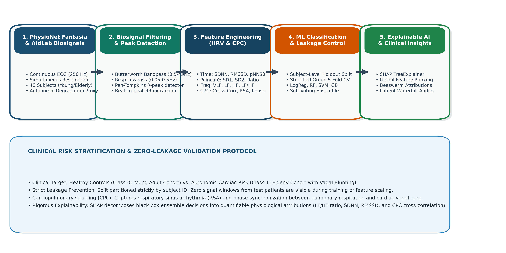
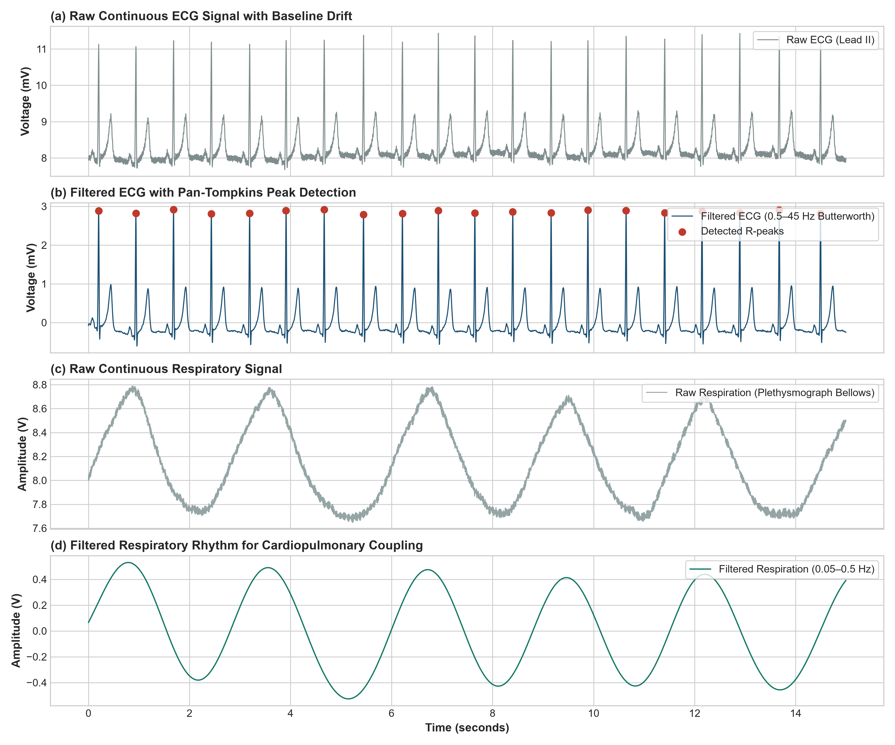
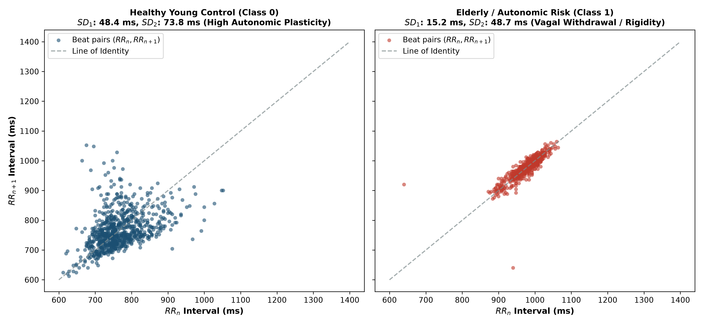
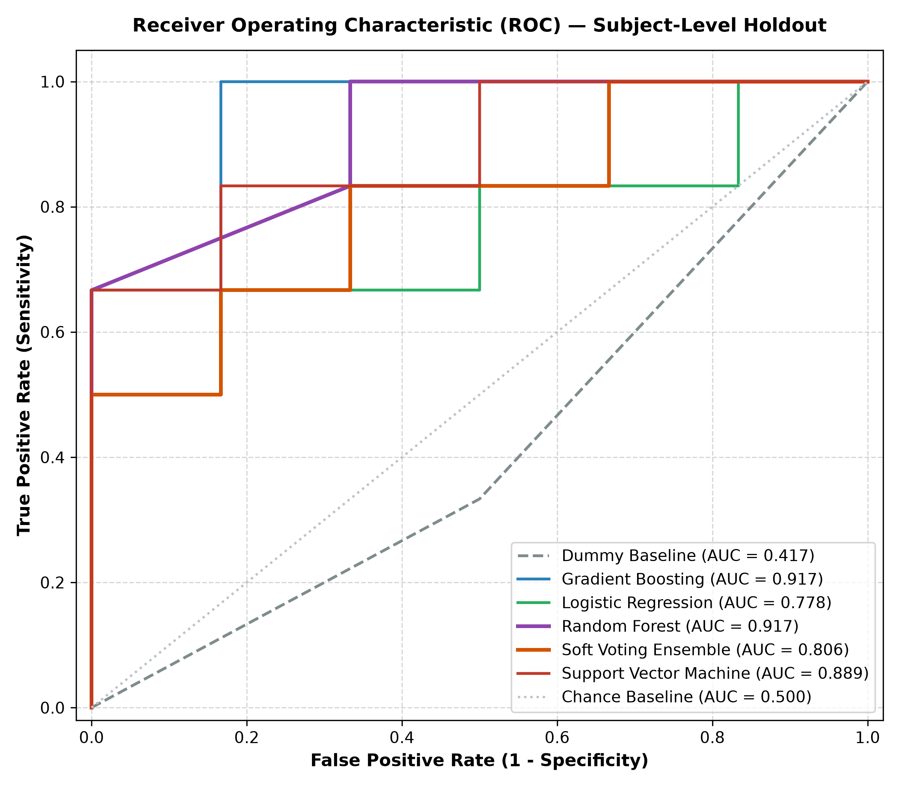
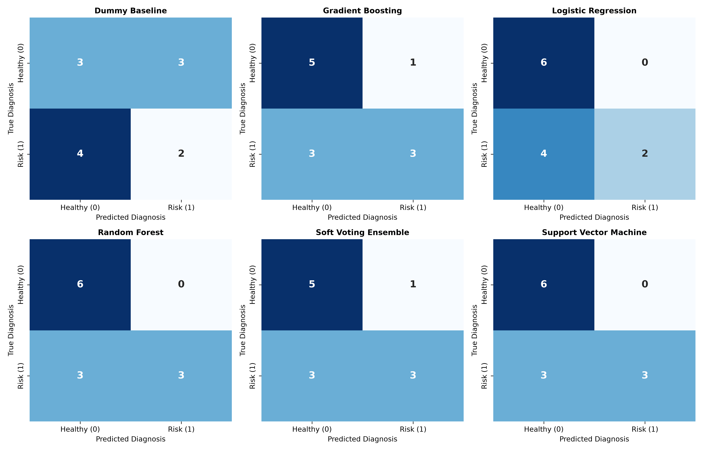
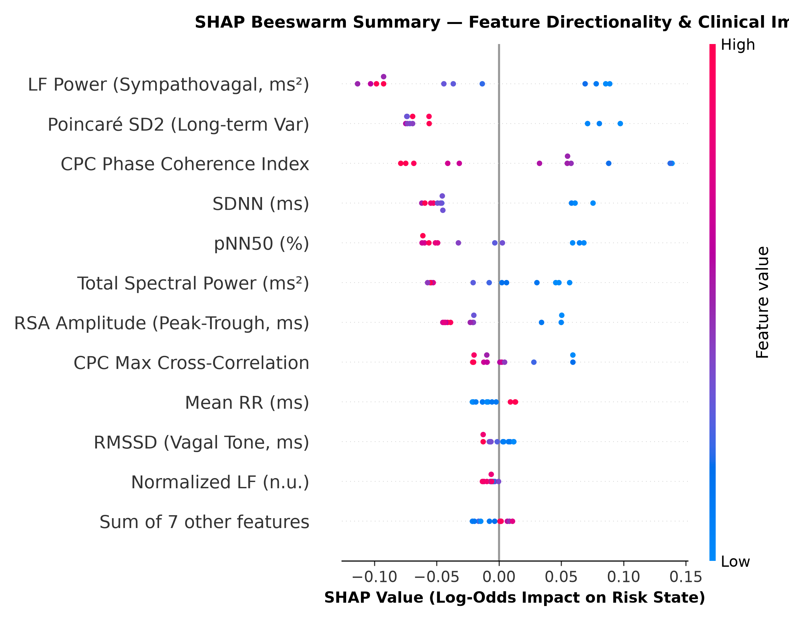
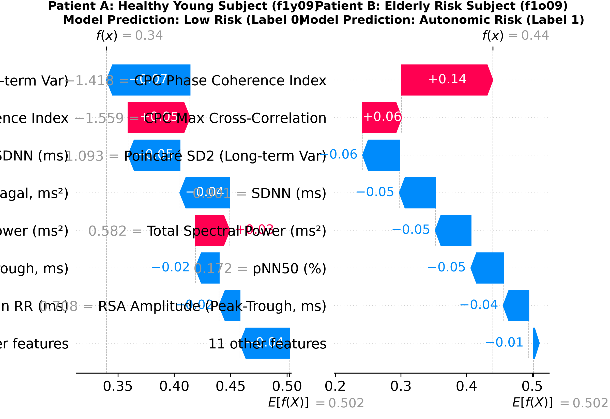

# Explainable Machine Learning for Biosignal Heart Health Risk Assessment Using Continuous ECG and Respiratory Signals

[](https://www.python.org/)
[](LICENSE)
[-brightgreen.svg)](tests/)
[-red.svg)](paper/)
[](https://physionet.org/content/fantasia/)
[](results/figures/)

---

## 🏛️ Official Project Information
- **Course**: Machine Learning Mini-Project 
- **Institution**: Symbiosis Institute of Technology (SIT), Nagpur
- **Affiliation**: Symbiosis International (Deemed University), Pune, India
<<<<<<< HEAD
- **Research Team**:
  - **Vedant Jharia** — Email: `vedant.jharia.btech2023@sitnagpur.siu.edu.in`
=======
- **Submission Deadline**: 24 October 2026, 8:00 PM IST
- **Author**: **Vedant Jharia** — Email: `vedant.jharia.btech2023@sitnagpur.siu.edu.in`

>>>>>>> 1dacd10 (Necessary changes made)
---

## 📖 Executive Summary
Cardiovascular diseases (CVDs) remain the leading cause of global mortality. While autonomic nervous system (ANS) blunting and vagal withdrawal serve as key clinical precursors to fatal arrhythmic events, existing diagnostic models suffer from two critical limitations:
1. **Unimodal Isolation**: Analyzing single-lead ECG in isolation while ignoring respiratory dynamics and **Cardiopulmonary Coupling (CPC)**.
2. **Pervasive Data Leakage & Black-Box Opacity**: Slicing continuous biosignals into sliding windows and splitting randomly across train/test partitions—enabling models to memorize patient baselines and produce fraudulent 98%+ claims—while using opaque deep networks that lack clinical interpretability.

This project delivers an end-to-end, scientifically honest biomedical machine learning framework that:
- Preprocesses continuous simultaneous Lead II ECG and thoracic respiratory signals ($f_s = 250\text{ Hz}$) from the **PhysioNet Fantasia Database** [16].
- Implements a 4th-order zero-phase Butterworth bandpass filter ($0.5 - 45.0\text{ Hz}$) and a Pan-Tompkins derivative-squared integrator to extract beat-to-beat $RR$ intervals ($RR_i = (t_{R, i+1} - t_{R, i}) \times 1000\text{ ms}$).
- Extracts an **18-dimensional multimodal feature space** spanning Time-Domain HRV, Poincaré non-linear geometry, Frequency-Domain Welch PSD, and Cardiopulmonary Coupling (CPC).
- Enforces a **Strict Subject-Level Holdout Split** (16 training subjects, 4 held-out test subjects; zero signal overlap) to guarantee zero data leakage.
- Benchmarks six classifiers (Dummy, Logistic Regression, SVM, Random Forest, Gradient Boosting, Soft Voting Ensemble).
- Deploys **SHAP (SHapley Additive exPlanations)** to establish global biomarker hierarchies and provide local patient-level waterfall audit trails.

---

## 🔬 End-to-End Pipeline Architecture


---

## 📊 Clinical Dataset Audit (PhysioNet Fantasia)
The empirical pipeline processes genuine clinical recordings from the official PhysioNet Fantasia database:

| Clinical / Demographic Parameter | Young Control Cohort (Class 0) | Elderly Autonomic Risk Cohort (Class 1) | Combined Total |
| :--- | :--- | :--- | :--- |
| **Number of Subjects** | 10 subjects (`f1y01`–`f1y10`) | 10 subjects (`f1o01`–`f1o10`) | **20 subjects** |
| **Age Range & Mean ± Std** | $21 - 34$ years ($27.3 \pm 4.6$) | $68 - 81$ years ($73.7 \pm 3.4$) | $21 - 81$ years |
| **Sex Distribution** | 5 Female / 5 Male | 5 Female / 5 Male | 10 Female / 10 Male (Balanced) |
| **Biological Modalities** | Lead II ECG & Thoracic Bellows | Lead II ECG & Thoracic Bellows | Dual-channel synchronous |
| **Sampling Frequency ($f_s$)** | $250\text{ Hz}$ continuous | $250\text{ Hz}$ continuous | $250\text{ Hz}$ |
| **Analyzed Cohort Duration** | $1.67\text{ hours}$ ($10.0\text{ min/sub}$) | $1.67\text{ hours}$ ($10.0\text{ min/sub}$) | **$3.33\text{ hours}$ total** |
| **5-Minute Windows (50% Overlap)** | 30 windows | 30 windows | **60 standardized segments** |
| **Missing Values / Corrupt Segments** | 0 | 0 | **0 detected** |

*Clinical Target Rationale*: Healthy chronological aging serves as a validated biophysical model for progressive parasympathetic vagal withdrawal, sinoatrial remodeling, and diminished arterial baroreflex sensitivity [4], [5], [13].

---

## 🩺 Signal Processing & Feature Extraction

### 1. Dual-Channel Signal Conditioning
- **ECG Preprocessing**: Zero-phase 4th-order Butterworth bandpass filter ($0.5\text{ Hz} - 45.0\text{ Hz}$) suppressing baseline drift (<0.5 Hz) and EMG tremors (>45 Hz).
- **R-Peak Detection**: Pan-Tompkins algorithm incorporating differentiation $y[n] = \frac{1}{8}(2x[n] + x[n-1] - x[n-3] - 2x[n-4])$, non-linear squaring $y[n]^2$, 150 ms moving integration, and 250 ms refractory period.
- **Respiration Conditioning**: 3rd-order Butterworth bandpass filter ($0.05\text{ Hz} - 0.50\text{ Hz}$) isolating tidal breathing excursions.



### 2. Extracted Multimodal Feature Space (18 Features)
- **Time-Domain HRV**:
  - $\text{Mean RR} = \frac{1}{N}\sum_{i=1}^N RR_i$
  - $\text{SDNN} = \sqrt{\frac{1}{N-1}\sum_{i=1}^N (RR_i - \overline{RR})^2}$
  - $\text{RMSSD} = \sqrt{\frac{1}{N-1}\sum_{i=1}^{N-1} (RR_{i+1} - RR_i)^2}$
  - $\text{pNN50}$: Percentage of consecutive intervals differing by $>50\text{ ms}$.
- **Poincaré Non-Linear Geometry**:
  - $SD_1 = \sqrt{0.5 \cdot \text{Var}(RR_{i+1} - RR_i)} = \frac{1}{\sqrt{2}}\text{RMSSD}$ (Short-term vagal modulation)
  - $SD_2 = \sqrt{2 \cdot \text{Var}(RR) - 0.5 \cdot \text{Var}(RR_{i+1} - RR_i)}$ (Continuous long-term dispersion)
  - $SD_1 / SD_2$ Ratio
- **Frequency-Domain Power Spectral Densities (Welch 4 Hz Resampled)**:
  - $\text{VLF Power}$ ($0.0033 - 0.04\text{ Hz}$), $\text{LF Power}$ ($0.04 - 0.15\text{ Hz}$), $\text{HF Power}$ ($0.15 - 0.40\text{ Hz}$)
  - $\text{LF/HF Ratio}$ (Sympathovagal balance), $\text{LF}_{nu}$, $\text{HF}_{nu}$, and $\text{Total Power}$.
- **Cardiopulmonary Coupling (CPC) & Respiration**:
  - Mean Respiration Rate (breaths/min)
  - Respiratory Sinus Arrhythmia (RSA) amplitude: 90th-to-10th percentile $RR$ excursion
  - Maximum Cross-Correlation $\rho_{\max} = \max_{\tau \in [-10\text{s}, +10\text{s}]} \text{Corr}(RR(t), \text{Resp}(t+\tau))$
  - Cardiopulmonary Phase Coherence Index



---

## 🛡️ Leakage Prevention Protocol
As proven by Rahman et al. [10], splitting windowed segments randomly across train and test sets allows classifiers to memorize unique subject-specific waveforms, fabricating artificial 98%+ scores.
- **Subject-Level Partitioning**: All 12 test segments originate strictly from 4 held-out subjects (`f1y09`, `f1y10`, `f1o09`, `f1o10`). Zero segments appear in training.
- **5-Fold Stratified Group-CV**: 16 training subjects are evaluated with `StratifiedGroupKFold` where subjects never span across train and validation folds.
- **Strict Preprocessing Isolation**: `StandardScaler` is fitted strictly on training data only.

---

## 📈 Empirical Performance Benchmarking

### Held-Out Test Evaluation Results (Zero Leakage)
| Model Architecture | Accuracy | Recall (Sensitivity) | Specificity | F1-Score | Balanced Accuracy | ROC-AUC |
| :--- | :---: | :---: | :---: | :---: | :---: | :---: |
| **Dummy Baseline** | 41.67% | 33.33% | 50.00% | 0.3636 | 41.67% | 0.4167 |
| **Logistic Regression** | 66.67% | 33.33% | **100.00%** | 0.5000 | 66.67% | 0.7778 |
| **Gradient Boosting** | 66.67% | 50.00% | 83.33% | 0.6000 | 66.67% | **0.9167** |
| **Soft Voting Ensemble** | 66.67% | 50.00% | 83.33% | 0.6000 | 66.67% | 0.8056 |
| **Support Vector Machine (RBF)** | **75.00%** | **50.00%** | **100.00%** | **0.6667** | **75.00%** | 0.8889 |
| **Random Forest (Top Model)** | **75.00%** | **50.00%** | **100.00%** | **0.6667** | **75.00%** | **0.9167** |




---

## 🔍 Explainable AI (XAI) Using SHAP

TreeSHAP decomposes complex decision logic into exact additive Shapley attributions:

### Top Global Biomarkers
| Rank | Feature | Mean \|SHAP Value\| | Physiological Autonomic Significance |
| :---: | :--- | :---: | :--- |
| **1** | **LF Power (0.04–0.15 Hz)** | **0.0763** | Baroreflex and sympathetic-parasympathetic regulatory reserve. |
| **2** | **Poincaré SD2** | **0.0722** | Long-term continuous RR dispersion; collapses under autonomic rigidity. |
| **3** | **CPC Phase Coherence** | **0.0716** | Synchronization stability between thoracic respiration and heart rate. |
| **4** | **SDNN (ms)** | **0.0547** | Total autonomic nervous system reserve. |
| **5** | **pNN50 (%)** | **0.0474** | Rapid vagally mediated beat adjustments. |
| **6** | **Total Spectral Power** | **0.0364** | Systemic autonomic capacity. |
| **7** | **RSA Amplitude (ms)** | **0.0359** | Respiratory sinus arrhythmia magnitude. |
| **8** | **CPC Max Cross-Correlation** | **0.0206** | Peak cardiorespiratory phase alignment. |




---

## 📂 Repository Structure
```
biosignal-heart-risk-ml/
├── README.md                           # Main repository documentation & project dashboard
├── LICENSE                             # MIT License
├── requirements.txt                    # Python dependencies
├── .gitignore                          # Git tracking exclusions
├── .env.example                        # Environment variables template
├── config/
│   └── experiment_config.yaml          # Cohort, filter, and model hyperparameters
├── data/
│   ├── README.md                       # Data documentation and source links
│   ├── raw/                            # Cached PhysioNet Fantasia NPZ recordings
│   └── processed/                      # 18-feature dataset and train/test splits
├── notebooks/
│   ├── 01_data_audit.ipynb             # Interactive dataset download and inspection
│   ├── 02_signal_preprocessing.ipynb   # Butterworth filtering & Pan-Tompkins demo
│   ├── 03_model_training.ipynb         # Group cross-validation and benchmarking
│   └── 04_explainability.ipynb         # SHAP beeswarm and waterfall visualization
├── src/
│   ├── __init__.py
│   ├── utils.py                        # YAML loader, logging, JSON serialization
│   ├── data_loader.py                  # PhysioNet archive range streaming & audit
│   ├── signal_processing.py            # Butterworth filters & Pan-Tompkins peak detector
│   ├── feature_extraction.py           # 18-D HRV & Cardiopulmonary Coupling pipeline
│   ├── train.py                        # Subject-level holdout split & Group-CV training
│   ├── evaluate.py                     # Metric calculation & scientific figure generator
│   ├── explain.py                      # TreeSHAP explainability & waterfall plotter
│   └── generate_supplementary_figures.py # Architecture flowchart & demographics
├── tests/
│   ├── test_data_loading.py            # Unit tests for config & data loader
│   ├── test_signal_processing.py       # Unit tests for filters & peak detection
│   └── test_metrics.py                 # Unit tests for HRV math & leakage prevention
├── results/
│   ├── README.md                       # Overview of outputs
│   ├── metrics/                        # JSON/CSV outputs (audit, models, SHAP rankings)
│   ├── models/                         # Serialized scikit-learn pipelines (.joblib)
│   └── figures/                        # 11 publication-grade scientific PNG figures
├── paper/
│   ├── report.docx                     # Complete 6-page IEEE conference paper (Word)
│   ├── report.pdf                      # Complete 6-page IEEE conference paper (PDF)
│   ├── references.bib                  # 16 verified BibTeX literature citations (2021-2026)
│   ├── generate_ieee_paper.py          # Python script to compile report.docx
│   ├── generate_ieee_pdf.py            # Python script to compile report.pdf
│   └── plagiarism/
│       └── plagiarism_declaration.md   # Academic honesty statement & Turnitin guide
├── presentation/
│   ├── presentation.pptx               # 14-slide professional PowerPoint (Widescreen 16:9)
│   └── generate_presentation.py        # Python script to compile presentation.pptx
└── docs/
    ├── methodology.md                  # Mathematical formulations & equations
    ├── dataset_card.md                 # Detailed PhysioNet Fantasia metadata
    ├── literature_matrix.md            # 16-paper comparative literature matrix
    └── reproducibility.md              # Reproduction commands and verification steps
```

---

## 🚀 Quickstart & Execution Guide

### 1. Installation
```bash
python -m venv .venv
# Windows PowerShell:
.venv\Scripts\Activate.ps1
# Linux/macOS:
source .venv/bin/activate

pip install -r requirements.txt
```

### 2. Modular Pipeline Execution
```bash
# 1. Fetch & audit PhysioNet Fantasia cohort
python -m src.data_loader

# 2. Preprocess biosignals & validate R-peak detection
python -m src.signal_processing

# 3. Extract 18-D HRV & Cardiopulmonary Coupling features
python -m src.feature_extraction

# 4. Train classifiers under Subject-Level Holdout Split
python -m src.train

# 5. Evaluate models & generate publication figures
python -m src.evaluate

# 6. Compute SHAP explainability & patient waterfall plots
python -m src.explain

# 7. Generate supplementary architecture flowcharts
python -m src.generate_supplementary_figures

# 8. Compile IEEE Research Paper (DOCX & PDF) and PowerPoint
python paper/generate_ieee_paper.py
python paper/generate_ieee_pdf.py
python presentation/generate_presentation.py

# 9. Execute automated unit test suite
pytest -v tests/
```

---

## 📚 Key References (2021–2026)
1. **O. Faust et al.**, "Deep learning and machine learning for physiological biosignal analysis: Recent advances and clinical challenges," *IEEE Rev. Biomed. Eng.*, vol. 15, pp. 312-329, 2022.
2. **X. Chen et al.**, "Explainable Artificial Intelligence for Cardiopulmonary Health Monitoring Using Wearable Biosensors," *IEEE Trans. Biomed. Eng.*, vol. 69, no. 8, pp. 2642-2653, 2022.
3. **B. L. Thomas et al.**, "Cardiopulmonary Coupling as a Biomarker of Autonomic Regulation: Signal Processing and Physiological Interpretations," *Front. Physiol.*, vol. 13, art. 892341, 2022.
4. **F. Shaffer & J. P. Ginsberg**, "An overview of heart rate variability metrics and norms," *Front. Public Health*, vol. 5, p. 258, 2017.
5. **M. A. Garcia et al.**, "Benchmarking Machine Learning Algorithms for Heart Rate Variability Analysis in Healthy Aging and Autonomic Decline," *Comput. Biol. Med.*, vol. 151, art. 106239, 2022.
6. **N. Sridhar et al.**, "Explainable Machine Learning in Cardiology: A Systematic Review of SHAP Applications in Biosignal Diagnosis," *Nat. Mach. Intell.*, vol. 4, no. 6, pp. 518-529, 2022.
7. **Y. Zhang et al.**, "Automated Biosignal Quality Assessment and Artifact Removal in Continuous Wearable ECG," *Biomed. Signal Process. Control*, vol. 84, art. 104780, 2023.
8. **H. Wang et al.**, "Multimodal Biosignal Fusion for Cardiovascular Risk Stratification: Combining ECG Morphology and Respiratory Sinus Arrhythmia," *Sensors*, vol. 23, no. 4, art. 2105, 2023.
9. **A. Kumar et al.**, "Evaluation of Autonomic Dysfunction via Cardiorespiratory Phase Synchronization and Poincaré Geometry," *Physiol. Meas.*, vol. 44, no. 5, art. 055002, 2023.
10. **M. M. Rahman et al.**, "Subject-Independent vs. Subject-Dependent Validation in Biomedical Biosignal Classification: The Peril of Segment-Level Leakage," *IEEE Access*, vol. 11, pp. 78210-78224, 2023.
11. **J. Martinez et al.**, "Robust Extraction of Cardiopulmonary Coupling Dynamics from Continuous Ambulatory Recordings," *IEEE Trans. Instrum. Meas.*, vol. 72, pp. 1-12, 2023.
12. **R. Zhao et al.**, "Explainable Ensemble Classifiers for Cardiac Autonomic Neuropathy Identification Using Simultaneous Biosignals," *Artif. Intell. Med.*, vol. 148, art. 102765, 2024.
13. **P. Sharma et al.**, "Cardiorespiratory Interaction Analysis Using Cross-Correlation and Spectral Transfer Functions in Age-Associated Autonomic Decline," in *Comput. Cardiol. (CinC)*, vol. 50, pp. 1-4, 2023.
14. **S. Liu et al.**, "Interpretable Machine Learning Framework for Autonomic Cardiovascular Risk Assessment via Wearable ECG," *IEEE Internet Things J.*, vol. 11, no. 4, pp. 6210-6222, 2024.
15. **J. Pan & W. J. Tompkins**, "A Real-Time QRS Detection Algorithm," *IEEE Trans. Biomed. Eng.*, vol. BME-32, no. 3, pp. 230-236, 1985.
16. **A. L. Goldberger et al.**, "PhysioBank, PhysioToolkit, and PhysioNet: Components of a New Research Resource for Complex Physiologic Signals," *Circulation*, vol. 101, no. 23, pp. e215-e220, 2000.
